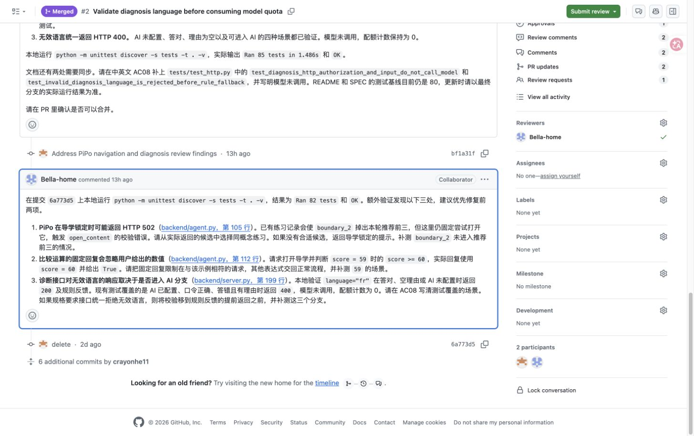
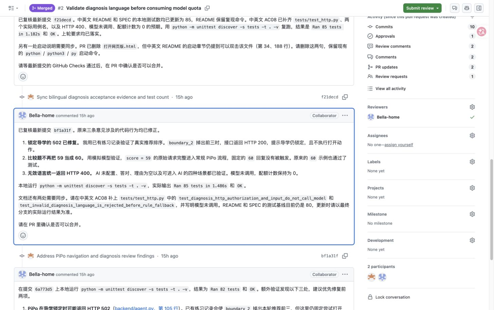
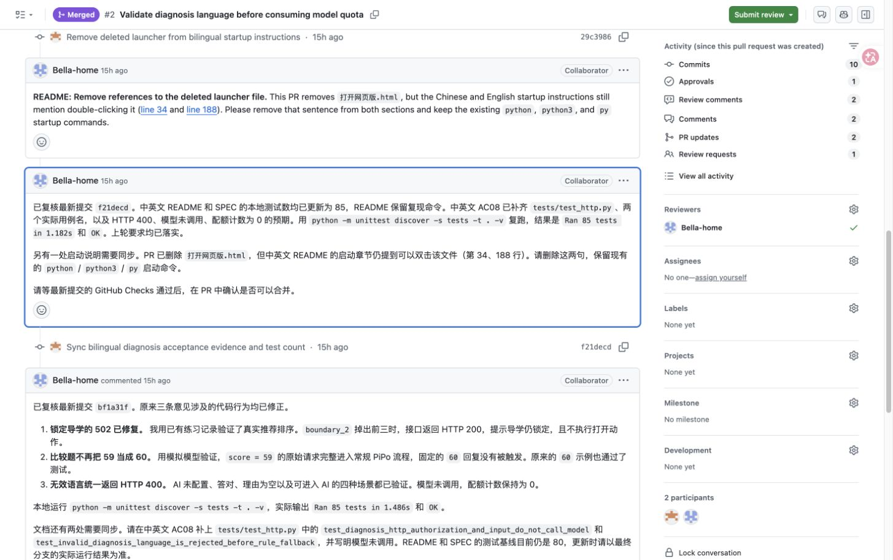
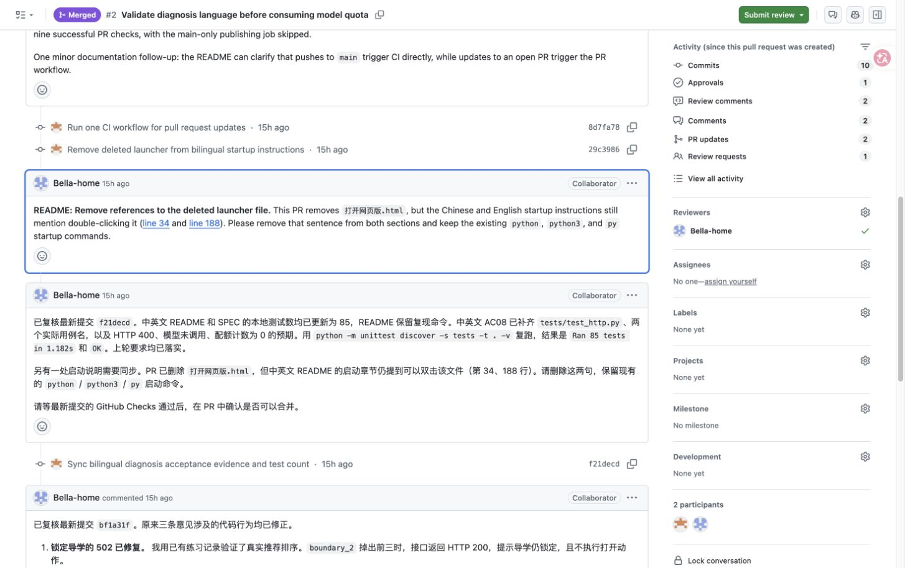
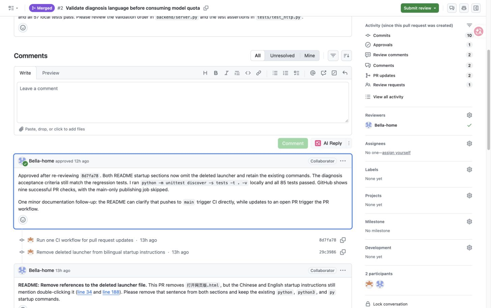
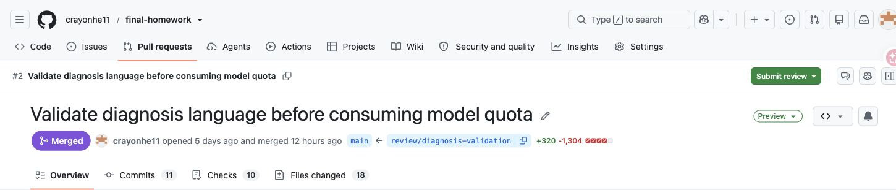
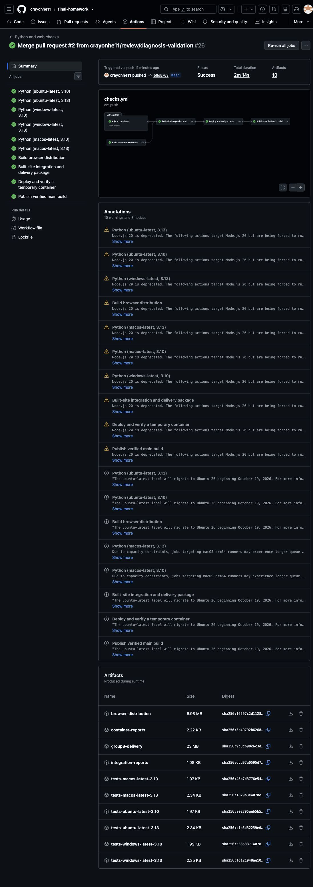

# PySteps Code Review 代码审查报告

The author is He Jiayun (HE JIAYUN), whose GitHub account is crayonhe11. The reviewer is Zhang Qin (ZHANG QIN), whose GitHub account is Bella-home.

### 1 Scope and participants

Group 8 reviewed changes from `review/diagnosis-validation` to `main` through GitHub PR #2. He Jiayun (crayonhe11) authored the changes, and Zhang Qin (Bella-home) conducted the independent review. The scope covered PiPo navigation, comparison explanations, diagnosis parameter validation, regression tests, bilingual documentation and CI. Following review, Bella-home approved commit `8d7fa78`. The author merged the PR through GitHub, producing merge commit `56d5763`.

### 2 Review method and baseline

The team used an asynchronous GitHub Pull Request review. The initial reviewed version was `6a773d5`. The reviewer read the changes, constructed boundary inputs and ran the tests, then recorded reproduction steps, observed behavior and suggested fixes in the PR. The author revised the original branch, and the reviewer verified the revisions and submitted a review decision.

The review used SPEC endpoint contracts, the actual question bank and navigation authorization rules as its baseline. Key files were `backend/agent.py`, `backend/server.py`, `tests/test_agent.py`, `tests/test_http.py`, `README.md`, `SPEC.md` and `.github/workflows/checks.yml`. The scope covered this PR's changes and related call paths.

### 3 Review checklist

The reviewer checked whether early returns bypassed parameter validation, navigation actions used observed candidates, changes in recommendation ranking caused invalid actions, model requests preserved user-provided values, regression tests checked side effects, and documentation matched the files and actual execution results.

### 4 Findings and fixes

| Finding | Cause and impact | Fix and verification |
|---|---|---|
| PiPo could return 502 when the lesson was locked and boundary_2 fell outside the top three recommendations | The fixed target had not been observed by recommend in the current turn, so open_content rejected it | bf1a31f selects a boundary-concept question from actual candidates, or returns a locked-lesson message with no action. A new test covers missing matching candidates. The reviewer also verified actual ranking. |
| A score=59 request received an explanation using score=60 and True | Broad keyword matching triggered a fixed example | bf1a31f restricts the fixed example to its specific trigger. Other requests use the normal workflow. A simulated-model test confirms that the original 59 request is forwarded. |
| language=fr returned 200 for correct answers, empty reasons or unconfigured AI | Language validation followed early returns for rule feedback | bf1a31f moves validation earlier. Tests cover the three branches and assert 400, no model call and a quota count of zero. |
| Documentation still stated 80 tests, and AC08 omitted test names | New tests and documentation were out of sync | f21decd updates both language versions to the 85-test baseline and names the two HTTP tests. |
| README still referred to double-clicking a deleted HTML launcher | Instructions had not been updated after deletion | 29c3986 removes the outdated sentence from both languages and retains the Python commands. |
| Push and PR updates started duplicate workflows sharing a concurrency group | Checks could cancel each other | 8d7fa78 limits push triggers to main. Open-PR updates trigger pull_request. Subsequent PR checks passed. |

### 5 Testing and verification

The reviewer recorded 82 passing local tests on `6a773d5`. After the fixes, 85 tests passed. New tests are `test_locked_boundary_without_matching_recommendation` and `test_boundary_request_with_different_score_uses_model_flow` in `tests/test_agent.py`, and `test_invalid_diagnosis_language_is_rejected_before_rule_fallback` in `tests/test_http.py`. The existing `test_diagnosis_http_authorization_and_input_do_not_call_model` continues to verify rejection and quota behavior in the AI branch.

Run `python -m unittest discover -s tests -t . -v` to reproduce the test run. Use `python3` on Mac or `py` on Windows as appropriate. Model branches use simulated responses to verify routing, argument forwarding and side effects. Live model explanation quality requires separate evaluation.

### 6 Approval merge and CI

Bella-home submitted APPROVED on `8d7fa78`, recording 85 passing local tests and nine successful PR checks. The main-only publication job was skipped on the PR. Main workflow `44114608031` for merge commit `56d5763` completed all ten jobs successfully, including six OS/Python combinations, browser build, integration and packaging, temporary-container verification and publication.

The reviewer also suggested clarifying the different triggers for main pushes and open-PR updates in README. This report retains that follow-up item.

### 7 Final decision and follow-up

The three confirmed code issues were fixed and rechecked by the reviewer. Both language versions now contain consistent test baselines, acceptance-test references and startup instructions. The final review decision was APPROVED. The PR was merged into main, and the post-merge workflow succeeded. Clarifying the CI triggers in README remains a low-priority documentation follow-up.

The author implemented the fixes, wrote regression tests and organized the evidence. Bella-home submitted the independent findings, verification and approval on GitHub. The record includes initial findings, revision commits, verification, approval and merge, traceable through the links and original comments below.

## Evidence

- [PR #2 review and merge record](https://github.com/crayonhe11/final-homework/pull/2)
- [Main branch workflow with all 10 jobs successful](https://github.com/crayonhe11/final-homework/actions/runs/44114608031)

### Figure 1 Initial review identifying three code issues

Initial review and three code findings.

### Figure 2 Verification of code fixes and requested documentation updates

Code fixes verified and documentation changes requested.

### Figure 3 Verification of 85 tests and outdated startup instructions

85 tests confirmed and stale startup instructions identified.

### Figure 4 English follow-up on the deleted launcher

English follow-up about the removed launcher.

### Figure 5 Final approval

Final approval after re-review.

### Figure 6 Pull request merged

Merged pull request.

### Figure 7 Main branch CI and publication

Main branch CI and publication.

## Appendix Review comments

The Chinese review comments below have been translated into English. The screenshots preserve the original comments.

### Bella-home COMMENTED on 6a773d5

I ran `python -m unittest discover -s tests -t . -v` locally on commit `6a773d5`. The output showed `Ran 82 tests` and `OK`. Additional checks identified the following three issues. I suggest prioritizing the first two.

1. **PiPo may return HTTP 502 when the lesson is locked.** Existing practice records can move `boundary_2` outside the top three recommendations. The code still attempts to open that fixed question, causing `open_content` validation to fail. Please select a question with the matching concept from the returned candidates. If no suitable candidate is available, return a locked-lesson message. Add a regression test for `boundary_2` falling outside the top three. See `backend/agent.py`, line 105.
2. **The fixed comparison response ignores the user-provided value.** A request to open the lesson and evaluate `score >= 60` with `score = 59` received an explanation using `score = 60` and `True`. Please restrict the fixed response to requests matching that example, route other expressions through the normal workflow, and add a test for the `59` case. See `backend/agent.py`, line 112.
3. **The response to an unsupported diagnosis language depends on whether the request enters the AI branch.** Locally, `language="fr"` returned HTTP `200` with rule feedback for correct answers, empty reasons or unconfigured AI. The existing test checks `400` when AI is configured, the team code is correct, and the answer is wrong with a non-empty reason. It also checks no model call and a quota count of zero. Please clarify this scenario in AC08. If the contract requires consistent rejection, move language validation before rule-feedback early returns and test these three branches. See `backend/server.py`, line 199.

[Original review](https://github.com/crayonhe11/final-homework/pull/2#pullrequestreview-5938087986)

### Bella-home COMMENTED on bf1a31f

I re-reviewed commit `bf1a31f`. The code behavior described in all three previous comments has been corrected.

1. **The locked-lesson HTTP 502 issue is fixed.** I verified actual recommendation ordering with existing practice records. When `boundary_2` falls outside the top three, the endpoint returns HTTP `200`, explains that the lesson remains locked and produces no opening action.
2. **The comparison response now preserves the requested value.** Using a simulated model, I verified that the original `score = 59` request reaches the normal PiPo workflow unchanged. The fixed `60` response is not triggered. The original `60` example also passes.
3. **Unsupported languages consistently return HTTP 400.** I checked unconfigured AI, correct answers, empty reasons and requests eligible for AI analysis. The model is not called and the quota count remains zero.

I ran `python -m unittest discover -s tests -t . -v` locally. The output showed `Ran 85 tests in 1.486s` and `OK`.

Two documentation updates remain. Please add `tests/test_http.py` and the test names `test_diagnosis_http_authorization_and_input_do_not_call_model` and `test_invalid_diagnosis_language_is_rejected_before_rule_fallback` to both language versions of AC08, and explicitly state that the model is not called. README and SPEC still state 80 tests. Please update the count using the actual result from the final branch.

Please confirm in the PR whether it is ready to merge.

[Original re-review](https://github.com/crayonhe11/final-homework/pull/2#pullrequestreview-5938300614)

### Bella-home APPROVED 8d7fa78

Approved after re-reviewing `8d7fa78`. Both README startup sections now omit the deleted launcher and retain the existing commands. The diagnosis acceptance criteria still match the regression tests. I ran `python -m unittest discover -s tests -t . -v` locally and all 85 tests passed. GitHub shows nine successful PR checks, with the main-only publishing job skipped.

One minor documentation follow-up: the README can clarify that pushes to `main` trigger CI directly, while updates to an open PR trigger the PR workflow.
